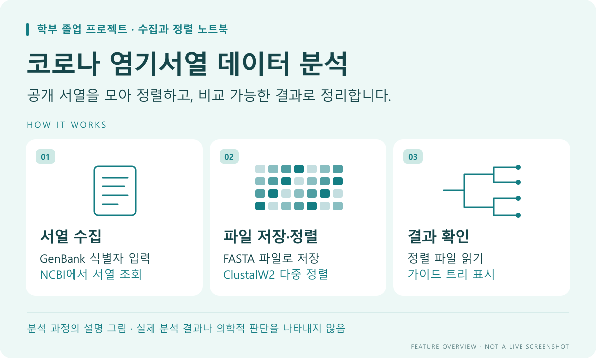

# 코로나 염기서열 데이터 분석

**공개 서열을 모아 정렬하고, 비교 가능한 결과로 정리합니다.**

공개 코로나바이러스 염기서열을 수집하고 여러 서열을 정렬해 비교하는 과정을 구현한 학부 졸업 프로젝트입니다. 이 저장소는 수집·정렬 노트북을 중심으로 구성되어 있습니다.



**학부 졸업 프로젝트 · 데이터 수집·정렬 구현**

### 핵심 기능

- **공개 데이터 수집** — GenBank 식별자로 NCBI의 염기서열을 조회합니다.
- **다중 서열 정렬** — 서열을 FASTA로 저장하고 통합 노트북에서 ClustalW2를 실행합니다.
- **결과 확인** — 정렬 결과와 ClustalW 가이드 트리를 확인합니다. MUSCLE은 별도 실험입니다.

**기술:** Python · Jupyter Notebook · Biopython · ClustalW2

[주요 파일](#주요-파일) · [팀의 결과·웹페이지](https://github.com/gudals7856/graduationProject)

> 상단의 요약 이미지는 **분석 흐름을 설명하는 도식**입니다. 실제 정렬 결과·가이드 트리나 의학적 분석 결과가 아닙니다. 팀의 결과·웹페이지는 [별도 저장소](https://github.com/gudals7856/graduationProject)에 있습니다.

## 기존 분석 이미지

저장소에 보관된 서열 비교 트리 이미지입니다. 가지와 서열 식별자가 표시된 기존 산출물을 확인할 수 있습니다.


---

<details>
<summary>상세 기능 펼쳐 보기</summary>

## 주요 작업

- **데이터 수집**: GenBank 식별자로 NCBI의 염기서열 조회
- **데이터 정리**: 조회한 서열을 FASTA 파일로 저장
- **다중 서열 정렬**: 통합 노트북의 ClustalW2 정렬과 별도 MUSCLE 실험
- **결과 확인**: 정렬 파일을 읽고 ClustalW의 가이드 트리(Newick)를 텍스트로 표시


</details>

## 분석 흐름

```text
GenBank 식별자 입력
    ↓ NCBI 조회
covid.fasta
    ↓ ClustalW2 정렬
covid.aln · covid.dnd
    ↓
정렬 결과 · 가이드 트리 확인
```

## 주요 파일

| 파일 | 역할 |
| --- | --- |
| [통합 분석 노트북](covid19/complete_list_alignment.ipynb) | 식별자 입력, 서열 수집, 정렬 및 결과 확인 |
| [목록 처리 노트북](covid19/list_alignment.ipynb) | 식별자 입력·서열 수집 후 MUSCLE 실행 |
| [MUSCLE 노트북](covid19/muscle_oper.ipynb) | 준비된 FASTA 파일의 정렬 실험 |
| [보조 스크립트](covid19/src/) | 개별 서열 수집·저장, 정렬 실행, 형식 변환, 트리 표시 실험 |

<details>
<summary>환경 준비와 실행 순서</summary>

### 사용 도구

Python, Jupyter Notebook, Biopython, pandas, ClustalW2를 사용하며 별도 노트북은 MUSCLE을 사용합니다. 패키지 버전은 저장소에 고정되어 있지 않아, 재현할 환경에서 노트북의 API 호환성을 확인해야 합니다.

### 실행 순서

1. 별도 작업 폴더에 `covid19/`의 노트북과 필요한 파일을 준비합니다.
2. `complete_list_alignment.ipynb`를 열고 NCBI Entrez의 이메일 설정을 본인 정보로 지정합니다.
3. `clustalw_exe`를 설치한 ClustalW2 실행 파일 경로로 수정합니다.
4. 분석할 서열의 수와 GenBank 식별자를 입력하고 데이터 수집 셀을 실행합니다.
5. 정렬 셀을 실행한 뒤 `covid.aln`과 `covid.dnd` 결과를 확인합니다.

노트북은 `covidlist.txt`와 `covid.fasta`에 데이터를 추가하는 방식입니다. 반복 실행 시 기존 데이터가 중복되지 않도록 이전 결과를 보관하고 새 작업 파일로 시작합니다.

### 보조 실험 코드의 상태

위 실행 순서는 통합 노트북 기준입니다. 보조 파일은 개별 실험 코드입니다. `src/run_muscle.py`는 Windows 경로 문자열 수정이, `src/clustal_to_fasta.py`와 `Untitled.ipynb`는 `seq_dict` 초기화가 필요합니다.

</details>

## 관련 자료

- [팀의 분석 결과와 웹페이지](https://github.com/gudals7856/graduationProject)
- [기존 사용 안내](https://github.com/ksmlucky/Graduation-Project-1/blob/1b31511157438de30b3257b63c8fa17d423c6b25/README.md)
